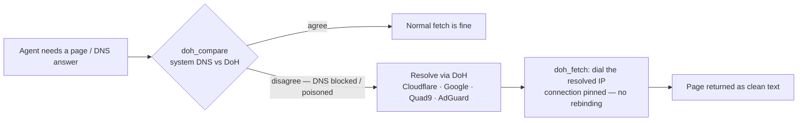

<p align="center">
  
  <h1 align="center">🩺 Dohctor</h1>
  <p align="center">A DNS-over-HTTPS <i>doctor</i> for your AI agent — diagnose a poisoned resolver, then heal the fetch.</p>
  <p align="center">
    <a href="https://github.com/neartana/dohctor/blob/main/LICENSE"></a>
    
    
    
  </p>
</p>

Your agent is only as good as the network underneath it. On many networks —
public Wi-Fi, corporate LANs, and ISPs that filter by DNS — name resolution is
**hijacked or poisoned**: domains fail, or quietly resolve to a block page.
The agent then blames the website.

**Dohctor fixes the diagnosis first.** It compares your system resolver
against an encrypted DNS-over-HTTPS (DoH) resolver, proves whether DNS is the
problem, and fetches pages through DoH so a DNS-level block never stops the
read. No API key, no account, one small Go binary underneath.

## ✨ Install

Pick one — both do the same thing:

```bash
# Option A: via the skills CLI (Muse, Claude Code, Cursor, …)
npx skills add neartana/dohctor

# Option B: direct installer, no skills CLI needed
npx github:neartana/dohctor
```

The installer copies the skill into `~/.agents/skills/dohctor` (or
`~/.claude/skills/dohctor`) **and downloads the `doh-mcp` binary for your
platform** into its `bin/` folder. Other targets:

```bash
npx github:neartana/dohctor --agent claude   # ~/.claude/skills/dohctor
npx github:neartana/dohctor --agent cursor   # ~/.cursor/skills/dohctor
npx github:neartana/dohctor --local          # ./.agents/skills/dohctor
npx github:neartana/dohctor --dir <path>     # <path>/dohctor
```

Then check it landed:

```bash
node ~/.agents/skills/dohctor/scripts/doh.mjs compare duckduckgo.com
```

## 🧠 How it works



| Tool | What it does |
| ---- | ------------ |
| **`doh_compare`** | Resolves a name with the system resolver *and* through DoH, and reports whether they agree — the diagnostic that detects a block, a hijack, or a local override |
| **`doh_resolve`** | Resolves A, AAAA, CNAME, MX, TXT, NS, SOA, PTR, SRV, CAA records through a DoH resolver, with TTLs |
| **`doh_fetch`** | Fetches an http(s) URL resolving its host through DoH and dialing the resolved address, so a DNS block does not stop the read. HTML is reduced to text |

## 🚀 Usage

The skill ships a zero-dependency helper that speaks MCP to the binary:

```bash
DOH=~/.agents/skills/dohctor/scripts/doh.mjs

# Diagnose first — is DNS the problem?
node $DOH compare duckduckgo.com

# Plain lookups through a trusted resolver
node $DOH resolve example.com A
node $DOH resolve gmail.com MX

# Fetch a page whose host is DNS-blocked
node $DOH fetch https://example.com 20000
```

Pick a different resolver with an env var:
`DOH_RESOLVER=google|quad9|adguard|https://your-doh-server/dns-query`.

Prefer native MCP? Register the downloaded binary directly in any MCP client:

```json
{
  "mcpServers": {
    "doh": { "command": "~/.agents/skills/dohctor/bin/doh-mcp", "args": ["-resolver", "cloudflare"] }
  }
}
```

## 📦 Requirements

| Tool | Why | Notes |
| ---- | --- | ----- |
| Node 18+ | runs the installer and the helper script | zero npm dependencies |
| `doh-mcp` binary | the MCP server doing the DoH work | downloaded automatically by the installer from the upstream release; or build from source with Go |
| Network | DoH queries + fetches | resolver endpoints: Cloudflare / Google / Quad9 / AdGuard, or your own |

## ⚠️ Honest limits

- **DoH defeats DNS-level blocks only.** If a network blocks by IP or by TLS
  SNI inspection, resolving correctly is not enough — Dohctor will diagnose
  that honestly instead of pretending otherwise.
- **Fetching search pages is scraping, not a search API.** It works, but
  search engines can rate-limit or CAPTCHA automated reads.
- **Not a privacy silver bullet.** Your DoH resolver sees your DNS queries;
  pick one whose logging policy you accept (Cloudflare 1.1.1.1 is the default).

## 🔒 Security

Inherited from the upstream server and kept intact: `doh_fetch` refuses cloud
metadata endpoints (`169.254.169.254`, `metadata.google.internal`) and
link-local addresses, re-checks every redirect, and pins each connection to
the address it resolved — which also defeats DNS rebinding. Loopback and
private addresses are allowed, so local documentation servers can be read.

## ❓ FAQ

**Is this a VPN?** No. Nothing is tunneled; only DNS answers and the fetched
pages travel differently. Your other traffic is untouched.

**Why not just change my system DNS?** You can — Dohctor exists for the cases
where you can't (locked-down machines, per-agent isolation), and for the
*diagnosis*: `doh_compare` tells you whether DNS was ever the problem.

**Which agents does it work with?** Any agent that reads `SKILL.md` skill
folders (Muse, Claude Code, Cursor, Codex, …) via the helper script, and any
MCP client via the binary directly.

**Do I need the binary if my agent has its own fetch?** For the diagnosis,
yes — a normal fetch uses the (possibly poisoned) system resolver, which is
exactly what Dohctor exists to check against.

## 🙏 Credits

Dohctor is an agent-skill wrapper around
[**99apps-id/doh-mcp**](https://github.com/99apps-id/doh-mcp) — the MCP server
that does the actual DNS-over-HTTPS work (Apache License 2.0). The installer
downloads its official release binary; see [NOTICE](NOTICE) for attribution.
Dohctor is not affiliated with or endorsed by the doh-mcp project.

## 📄 License

[MIT](LICENSE) © neartana — for the skill in this repository.
The `doh-mcp` binary remains under the Apache License 2.0 (upstream).
